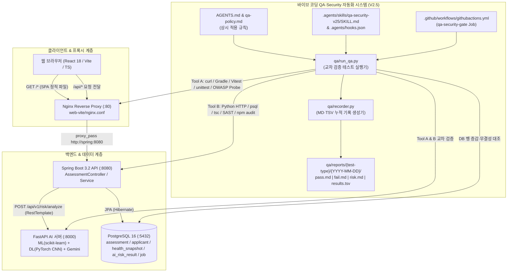
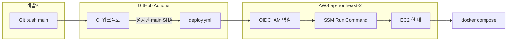

# IF_v2 시스템 및 QA·Security 자동화 아키텍처 (`docs/ARCHITECTURE.md`)

## 1. 전체 시스템 및 QA·Security V2.5 아키텍처 다이어그램

---

## 2. 아키텍처 변경 이력

| 일자 (KST) | 버전 | 변경 대상 | 변경 내용 요약 |
| :--- | :--- | :--- | :--- |
| 2026-10-30 | V2.5 | `AGENTS.md`, `qa-policy.md`, `.agents/`, `qa/`, `.github/workflows/githubactions.yml` | 바이브 코딩 QA·Security 자동화 지침 V2.5 구축 (최소 2개 도구 교차 검증 실행기, 날짜별·종류별 4종 리포트 생성기, Antigravity 훅/스킬, GitHub Actions CI 게이트 연동) |
| 2026-10-31 | 인프라 코드 | `infra/`, `.github/workflows/githubactions.yml` | 기존 EC2·Compose 배포를 Terraform, Kubernetes 매니페스트, Prometheus 규칙으로 코드화. AWS 에는 적용하지 않음 |

## 3. 지금 돌아가는 경로와 CI/CD

운영 경로는 Kubernetes 가 아니다. EC2 한 대에서 `compose.yaml` 이 Postgres, Spring, FastAPI, Nginx 를 띄운다. 배포는 GitHub Actions 가 OIDC 로 AWS 역할을 맡은 뒤 SSM 으로 `scripts/deploy.sh` 를 실행한다.

Kubernetes 매니페스트는 같은 컨테이너를 다른 실행 환경에 올리기 위한 정의다. 클러스터에 배포하지 않았다. 상세는 `docs/infrastructure.md` 에 있다.
